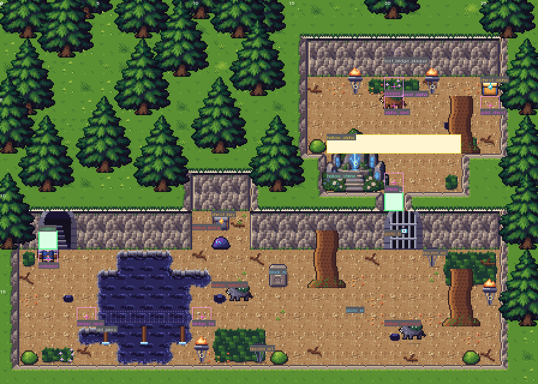
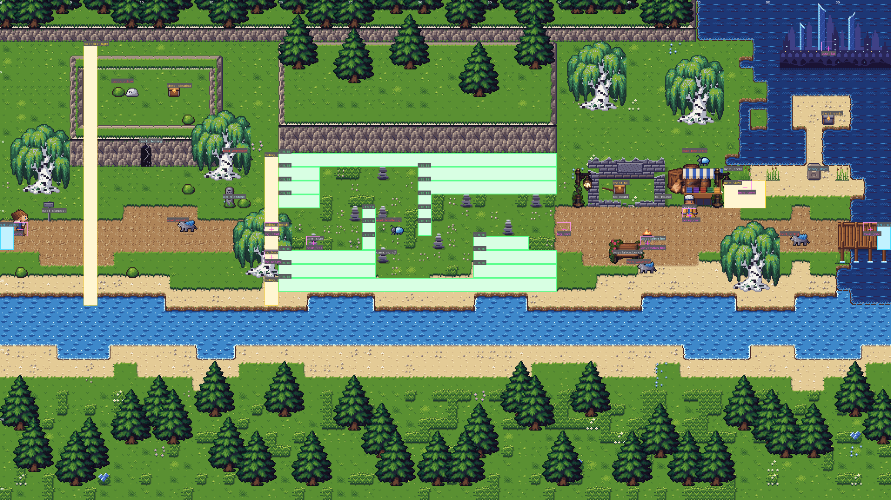
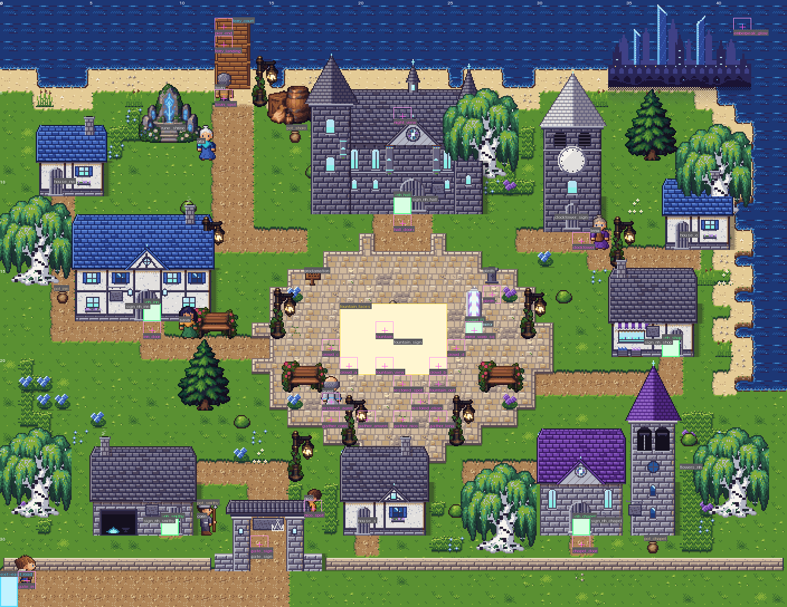
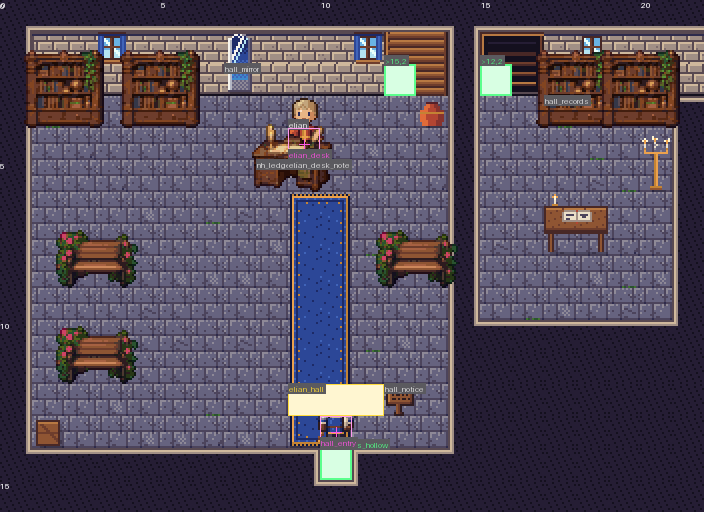
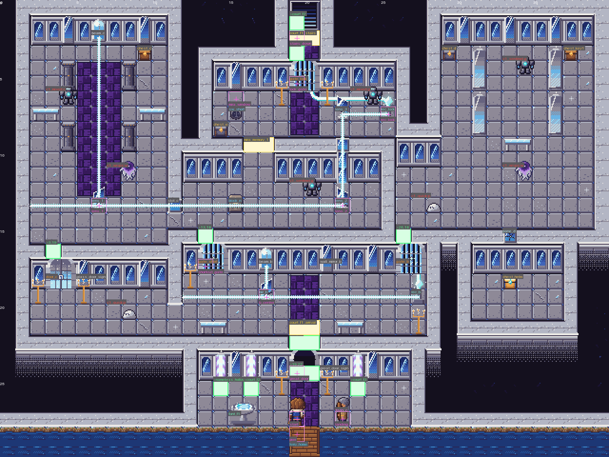
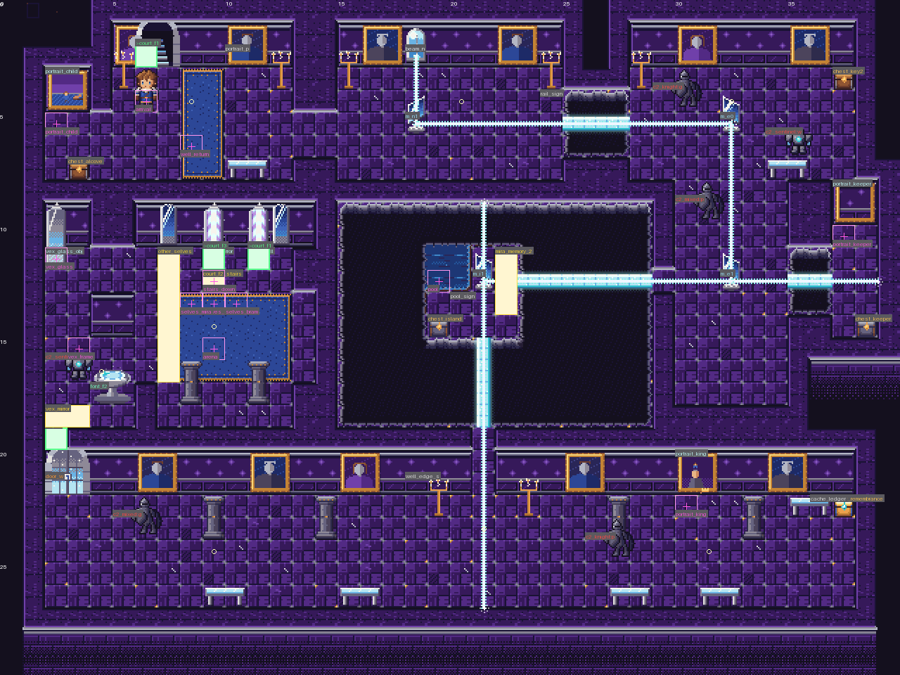
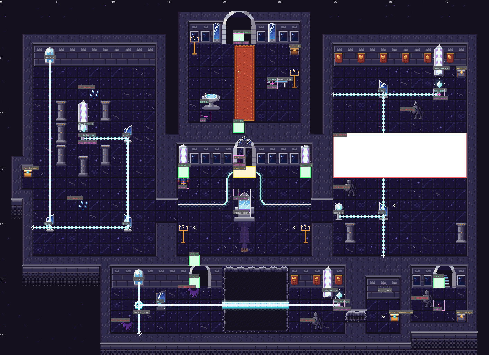
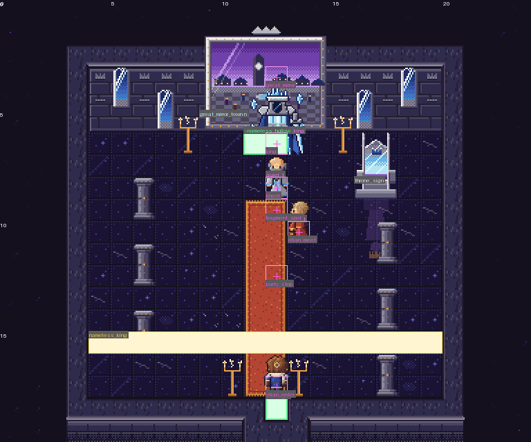

# Maps: Episode 1 (W2-maps) and Episode 2 (E2-maps, section 6)

Every Episode 1 map is a data module in `src/data/maps/<id>.js` (DESIGN 5.1 plus the fields in section 2).
Helpers live in `src/data/maps/_kit.js`; the default export is always a plain, JSON-serializable object.
Tools: `tools/maps/mapcheck.mjs` (dump, validate, walk), `tools/maps/preview.py` (PNG previews).
Tests: `qa/maps/maps.test.mjs`. Annotated overviews (2x) are in `tools/maps/previews/`.

```bash
node tools/maps/mapcheck.mjs check                 # every map: ids, targets, NPC coverage, plans, STAGING marks, walk
node tools/maps/mapcheck.mjs dump willowmere       # the resolved module as JSON
node tools/maps/mapcheck.mjs walk archive_f1       # gate-aware reachability report
python tools/maps/preview.py willowmere --walk     # tools/maps/out/willowmere.png (3x, labels) + _clean.png
python tools/maps/preview.py archive_f3 --crop=27,9,13,12 --scale=4
python tools/maps/preview.py --all --scale=2
```

---

## 1. Conventions

- **Coordinates** are tiles, `(0,0)` top-left. `ground` rows are strings; the legend maps a character to a
  terrain, `<wall>_top` / `<wall>_face`, a plain tile or a line16 tile (ids from `assets/tiles/tiles.json`).
- **3/4 view walls.** Rooms are carved out of a grid of wall top (`#`): the floor rectangle plus two face rows
  (`|`) above it (`room()` in `_kit.js`). Walls that run north-south show only their top. Outside the rooms the
  top fill draws as dark roots (archive) or dark plaster (interiors).
- **Doors and stairs set into a face** (`door_key_*`, `door_locked_*`, `door_boss_*`, `stairs_*`, `stairs_in_*`,
  the valley's `door_double_*`) are **transfers**: the object sits in `decor` at its doorAt cell and a `door`
  event on the same cell carries `to`. Inside one dungeon floor the far side is a one-cell floor **notch** cut
  into the destination room's south wall strip, with a return `door` on the notch (event ids `notch_*`). The
  engine never fires a door on placement, only on stepping onto it.
- **Interiors** exit through a gap in the south wall; the town door's `to` lands on that gap cell facing up,
  the interior's exit lands on the tile in front of the building door facing down (tested).
- **Overlays** are decal/plain tiles drawn over the ground cell. The overlay's own collision replaces the
  cell's: bridge decks over water are walkable, bridge piles/arches stay water, `wall_broken` over a face is a
  walkable hole, `ink_bridge_*_faint` over ink is a `pit` until the Lantern reveals it, `plate_*`, `switch_*`,
  `roots_*`, flowers are `none`. A 16x32 overlay applies to both rows it covers.
- **Decor** entries are tiles.json objects (anchor = bottom-left footprint tile) or props.json objects
  (`x,y` = left tile of the bottom footprint row), with `state` = frame index when the object has frames
  (`lamp_post` 1 = lit; the field overrides a lamp's state by time of day: lit under dawn/dusk/night and in
  dark maps, unlit by day). Plain tiles with `w`/`h` repeat.
- **Mechanism events draw themselves** (`block`, `plate`, `switch`, `shelf`, `gate`, `locked_door`,
  `brazier`, `font`, `chest`, `pot`, `object`): no duplicate decor. `gate`/`locked_door` with a 32 px door sprite
  own both doorway cells (`w: 2`); `door_boss` owns three.
- **Signs** sit on the solid thing they describe (a wall face, a building footprint cell, a prop) and are read
  from the adjacent floor; `solid: false` means the event adds no collision of its own.
- **Marks** (`marks: { name: [x, y] }`) are the named points scenes refer to (STAGING.md section 5 plus a few
  extras). Marks that scenes walk actors to are tested walkable and reachable.
- `start: { x, y, dir }` is the default spawn (debug warps, tests). `under` is the terrain drawn beneath walls
  and plain tiles. `pitTo` is where `pit` cells drop you unless a `pit` area event overrides it.

## 2. Event vocabulary (agreed with W2-world)

Every event: `{ id, type, x, y, if?, ifNot? }`. The event exists only while its flag conditions hold.

| type | fields | notes |
|---|---|---|
| `npc` | `dir` | `id` = `npcs.js` id; sprite, movement, presence and talk come from `NPCS` |
| `actor` | `sprite, dir` | scripted map actors `echo_warden`, `archivore`; the F2 ink readers carry `ghost: true, solid: false` |
| `door` | `to: [map,x,y,dir], kind: 'door'|'stairs', w?` | transfer on step; same-map transfers allowed |
| `chest` | `tier, item?, qty?, flag?` | no `item` = `rollChest(tier)`; one-shot via `engine.game.opened`; `flag` only on `stacks_key` |
| `sign` / `book` | `text` / `book`, `tile?`, `fade?`, `lantern?` | `fade` = `shop|inn|square|gate` for the flag-driven blank states; `lantern: true` = readable once revealed |
| `object` | `sprite, script?, text?, solid?, state?, rest?` | inspectables: letters, milestone, pedestal, nest, bell, the boss door; flag swaps are two events with `if`/`ifNot`; `rest: true` (the valley campfire) runs the font's rest flow after the script |
| `trigger` | `w, h, script, on?` | `on: 'enter'` runs after the fade-in; default = step; scenes guard themselves |
| `enemy` | `sprite, encounter, move, path?, radius?` | `move` = `wander|patrol|chase|guard`; dungeon enemies step only when the player steps |
| `switch` | `target, kind: 'floor'|'crystal', color?, state, hidden?` | toggles on interact; every target fires |
| `plate` | `target` | down while a block or party member stands on it |
| `block` | `heavy?` | push block, resets on re-entry; `heavy: true` only moves for Bram's Shove (W9) |
| `gate` | `sprite, state, to?` | opens when **all** switches/plates targeting it are on; with `to` it is then a door |
| `locked_door` | `key, sprite, to` | interact with the key; `archive_key` is consumed |
| `shelf` | `positions, state` | slides between positions when a switch targeting it fires |
| `pot` | `item?, qty?, gold?` | breakable, respawns on re-entry |
| `brazier` | `lit` | interact to light; a light source in dark maps |
| `font` / `save` | `text` | Keeper's font (full heal) / chapel bell (save); both set the game over return point |
| `ferry` | `text, to, rideIf` | the post is readable always; the ride needs `nella_bell_done` |
| `light` | `r, color?` | extra light source; `r` under 16 is in tiles (F3 uses 4 to 7), otherwise pixels |
| `pit` | `w, h, to` | overrides `pitTo` inside an area |
| `object` + `breakable` | `breakable` (`roots` or `rock`), `text, h: 2, opens?` | W9: Dash Strike breaks it (art from `src/world/fieldart.js`; the module's `sprite` is the tiles.json stand-in the tools draw); `opens` wall cells become floor once broken; saved in `game.opened` |
| any | `behind: '<id>'` | W9: hidden until the breakable `<id>` is broken (the valley grotto chest) |

`object` / `actor` / `trigger` may add `safe: true` (the F2 Lantern pedestal): using it makes the party's
tile the game over return point. A map may add `ambientFx: ['motes']` (the library) to its ambient life;
see docs/WORLD.md 1b. Stairs transfers and map-to-map doors set the return point by themselves; same-map
notch doors and pits do not. W11: a `field` map may add `respawn: 'reentry'` (the Fading Road): its beaten groups stay
gone until the party enters the map from another map, instead of returning after 60 s (DESIGN 5.2's field rule).

## 3. Collision and the walk model

`tools/maps/mapcheck.mjs buildGrid()` derives the collision grid exactly as section 1 says (terrain code, wall
systems solid, overlay override, decor footprints solid except doorAt/passable cells, door cells walkable,
gates and locked doors solid until opened, standing events solid). `walk()` floods from `start` with
4-direction moves, one-way ledges, pits (drop to `pitTo`), same-map door transfers, and iterates the gates: a
gate opens when all of its sources are reachable (a plate also needs a push block on the map), a locked door
when its key chest or pot is reachable, hidden ink becomes walkable once the Lantern pedestal is reachable (or
`{ lantern: true }` is passed), shelves become passable once their switch is reachable. Enemies, blocks, pots
and actors are passable for the flood (fought, pushed, broken, despawned). The test suite asserts the critical
path, every chest and every story mark from this model.

---

## 4. The maps

### hero_home (18 x 13, interior)

Sleeping loft (left) and Hazel's main room (hearth, loom, table, bookshelf). `bed` = (4,3) = `START_POS`;
`bedside` = (3,3); the tile below the bed is floor. Hazel starts by the hearth (13,4). Six inspect lines.
Exit (12,11) lands on the town tile in front of the front door (4,16).

### willowmere (48 x 32, town)

Lantern Square (plaza, the well, Mael, Wick, Lark, benches, stalls, lamp posts, the LANTERN SQUARE sign)
with the chapel and bell tower north of it, the library east (chicken run behind it, Cobb and the hens, its
gate on the east bank), the hero's home and bakery on the west lane with Loaf's alley between them, the inn and
ferry pier north-east, Edda's twelve beds and the thirteenth on the bank along the river road, the Duke's nest
in the reeds, the main road south through the south square (notice board, Tess) to the gate (Bram left post,
Holt right post, the WILLOWMERE sign in the arch), item shop south-west, smithy south-east, five homes with
gardens, a low town wall along the south edge. Every shop sign is a `sign` event with `tile` and `fade`.
Triggers: `fading_sign` on `home_door`, `south_gate` on `gate_inner` (row 28), `leave_town` in the arch (row
29), `return_to_willowmere` on enter. Exit: the gate row 31 to the valley's south-west corner; the ferry pier to
the valley north landing once the bell is back.

### Interiors

`bakery` (Oren behind the counter by the oven, Hal by the flour bin after the Archivore, the crock),
`inn` (taproom with Hob, the stair to the guest rooms where Barnaby sleeps), `item_shop` (Pell), `smithy`
(Garrick at the anvil by the forge, the runaway starter on the warm bricks beside it, Anvil the dog by the
door), `library` (Iris at her desk facing the door, Mira at her reading table facing the shelf, `mira_meet`
two tiles inside the door, seven books, the globe, the returns cart, a mezzanine by stair), `chapel` (altar,
pews, the bell-tower base with Pip under the ropes, the hand-bell save point by the door). Previews:
`tools/maps/previews/<id>.png`.

### valley (60 x 40, field)

Enter from the town gate at the west edge (1,33). The road runs east to the stone bridge (Penny's cart and
crates at the far end), the pilgrim road north along the east bank with a jog around the willow, the fork
(milestone object, fork signpost, the Pilgrim's Rest: campfire, log benches, Quill, and the pilgrims' note
`pilgrim_note` on a post at (40,25) that hints at the Whisperwood pool and its ink crossing), the east road ending at the
washed-out ford of a tributary, the Whisperwood pines on the east edge, and the Rootbound Archive grown into
the north cliff: the great door in the rock face under three willows with root columns, `door_step` (36,7) with
open tiles each side, `root_exit` (39,7) where the boss chamber's passage comes out. North landing: sand, pier,
the empty bell post (`ferry` event), Nella's bell glinting in the shallows just downstream. West: the meadow,
a fenced pasture, the hollow willow (wood chest: Echo Herb x2 under the canopy), a cliff plateau with stairs,
an iron chest (spare Hatchet) and a grassy ledge for a one-way hop down. W9: the plateau's south face is cracked at (4,14) (`crack_plateau`,
west of the first-fight cut, so the dash can be tried first); Dash Strike opens a grotto with an iron chest
(`chest_grotto`, Phoenix Feather, `behind` the crack). Secrets: the Whisperwood clearing's
ink pool with a hidden ink bridge to a gold chest (Pilgrim's Reach; needs the Lantern, so it is found on the way
home), and on the pool's north-west edge a ruined root arch (`arch_ruin` (50,27)) whose middle cell is the door
`hollow_mouth` (51,27) down into Whisperwood Hollow (mark `hollow_mouth` (51,28), where the party comes back up).
W10: the step trigger `valley_lantern_hint` across row 17 above the fork (34..46) runs `quill_reminder` once after
the Lantern (one Mira box pointing at the pool, or at Quill). Seven visible enemies per the plan: the wolf pack `e_wolves_a` chases at the road's bend (14,33) and the
step trigger `first_fight_trig` (column 7, rows 6 to 39, a full cut of the map) runs the scripted first fight
before the pack can be walked past;
the pack deepest by the Archive. The campfire (39,22) is an `object` with `script: 'campfire_rest'`, `safe` and
`rest` (the fireside scene, then the rest flow); the log bench carries `pilgrim_bench`. Rain zone: the north half
(`weatherZone`). Shapes: the roads bend and widen (one span per row in `ROAD` / `PILGRIM`), tall grass is
value-noise blobs kept one cell off the roads, the tributary and the ink pool have ragged banks, the cliff-top
tree line is broken.

### archive_f1 (40 x 30): The Catalog Halls

Entrance hall A with the catalog drawer wall (`catalog_drawer` (19,22) faces it), the Catalog Promise plaque,
the ledger and the marginalia desk. **Critical path:** east corridor to the plate room H (push two blocks onto
two plates between the root columns; the barred door opens) into the east wing I (three fights, iron chest,
shelf aisles) and its key door, then the stairs landing J where the bell tolls (trigger row 4) and the stairs
down. **The key:** west corridor to the pot storeroom C: break the pots to free the push block, push it west
four and north two onto the plate; the barred door opens into the key alcove D (wood chest, Archive Key).
**Optional:** the moss alcove E (Tess's letter 1) with a broken wall into the hidden cell F (iron chest, the
Wayfarer Mantle); wood chest in the antechamber B. **Shortcuts:** the bell (`archive_f1_done`) opens the Keepers' back-stair,
`stairs_up` objects and same-map stairs doors both ways between the landing J (33,3) and B (7,23), so a trip to
town from F2 and back skips the floor; the F3 shortcut surfaces in B's north face (10,23) once `archive_f2_done`
is set. The key chest `chest_d` sets `archive_key_found` (the Talk hint turns east). Eight enemies as planned
(slimes in B and the corridor, mites guarding the pots and the alcove, wraiths and mixed groups in H and I).
W9: in C, beside the light push block, the heavy block `heavy_c` (6,10) stands in front of a niche in the north
face (`wall_broken` at (6,8)) with the iron chest `chest_niche` (Silver Circlet). The hero alone only rocks it;
Bram's Shove moves it one tile either way and clears the niche.

### archive_f2 (40 x 30): The Reading Galleries

One long gallery band cut by ink moats: the Echo Warden's rotunda (west) | ink | the Reading Hall hub | ink |
the stairs room (east). Ghostly readers sit at the desks of the entry hall and the hub. The hub's floor switch
slides two shelves along their rails so only one south doorway is open at a time (start: east open). East
wing: the reading rooms, Tess's letter 2 (south-east), the Iron Pike chest. West wing: the long gallery, the
Chain Shirt chest, then north through the gallery's wall into the rotunda from the south: the Warden faces down
over the Lantern pedestal (trigger row 16 across the rotunda). With the Lantern, the ink beside the pedestal
reveals a bridge straight back into the hub (the shortcut), and the hub's east moat reveals the bridge to the
stairs room (`archive_f2_exit` trigger in front of the stairs, `hidden_ink_2` on its wall, the Keeper's font
`keeper_font_f2` at (34,17), 4 x 2, `safe`: the floor's heal and save after the Lantern). W10: a second font,
`keeper_font_f2_hall` at (15,5) in the entry hall's north-west corner beside the stairs up (text `keeper_font_hall`,
`safe`, mark `font_hall`), is the rest point before the Warden; the west reading desk and its ghost reader moved
down a row for it (PLAYTEST_REVIEW_2 fix 1). Seven ordinary enemies plus the Warden.
Faint bridges are pits until revealed (`pitTo` = the hub).

### archive_f3 (40 x 30): The Rootbound Stacks (dark 0.7)

**Main path:** entry (north-west) down into the western stacks (dark; three braziers to light; shelf aisles
split by roots; letter 3 wedged between roots at (3,17)), south through the corridor to the bell hollow (the
thirteenth bell between two root columns, trigger at the hollow's mouth, braziers), east to the great door hall:
the boss door with its plate and `hidden_ink_3` beside it, the Keeper's font, the shortcut stairs back to F1's
antechamber, and (W10) Rook the salvager at (25,23) by the font: the Archive's shop (`archive_salvage`, tier 3
weapons, bronze plate, consumables at a markup), the gold sink before the Archivore. **Branches:** the crystal room (three crystal switches, all lit opens the barred door to the key
room above: the gold chest with the Stacks Key, the Keeper's third journal, the broken chronicle; the plaque
`crystal_plaque` beside the barred door reads THREE LIGHTS, ONE DOOR); the pit room (a golem and a patrol among
the pits; falling drops into the cache below: a gold chest, a brazier, and across a hidden ink bridge the First
Quill; the cache's stairs climb back to the pit room, one way; the module's `ambientFx: [{ fx: 'page_fall', at: [29, 14], area: {...} }]` drops one page into the nearest pit the first time the party steps into the room, the tell before the first fall). Eight enemies with ink wraiths in the stacks and
the corridors: the unavoidable corridor patrol to the bell hollow (5,20) is the lighter `f3_ink` group and the
two-wraith `f3_wraiths` guard sits in the letter alcove (3,14), which can be walked around (PLAYTEST_REVIEW_1 3).
W9: the great door hall's north face has a doorway choked with thin roots at (14,20..21) (`roots_gd`, between two
bookcases). Dash Strike from the hall breaks it and carves the wall band (14,19): a two-way shortcut up into the
western stacks (14,18) for the key-room trip, opened only from the hall side (from the stacks it is plain wall until
then). The stacks' root column moved from (13,18) to (11,18) to clear the landing.

### archive_boss (24 x 20): Heart of the Archive

A hollow inside the willow: root columns, ink seeping from the walls, a carpet of pages up the middle. The
party enters from the south notch; the Archivore feeds at the north end over the blue carpet (`archivore`
(12,6), `fragment_spot` (12,9)). After `archivore_defeated` the root passage opens in the north face
(`root_exit` (16,4)) and leads out to the valley beside the Archive door.

### whisperwood_hollow (28 x 20, dungeon, dark 0.5): Whisperwood Hollow (optional)

A sunken root hollow under the Whisperwood pines (town tileset: cliffs, pines on the rim, dirt and moss floor,
archive `roots_*` decals, `root_column` pillars, ink). Music `mystery`. The valley's root arch lands on the stairs
landing (`entrance` (2,13), stairs back up at (2,12)). A black ink pool cuts the landing off from the main
hollow: the pilgrims' lost bridge is five `ink_bridge_h_faint` cells on row 16 (`bridge_near` (4,16) to
`bridge_far` (10,16)), so nothing past the pool is reachable before the Lantern; the rotten piles beside it
(`old_piles`, read from the near shore) and the `hollow_entry` scene tell the story either way. Main hollow:
two `hollow_wolves` (one chases, one patrols), the elite `hollow_blot` guarding the iron chest `chest_bay` in the
north notch (11,11), two unlit braziers to light and two already burning. Puzzle: push `block_m` (14,14) onto
`plate_m` (18,16); the root column at (16,14) blocks the straight push, so it goes down two, then east four. The
plate opens the barred `gate_b` (20,12) to the notch (20,10) and the shrine vestibule (17..23, 8..9; W10): the
pilgrims' shrine `hollow_shrine` (`rune_shrine` prop, 3 x 2 at (17,9), a `font` with text `pilgrim_shrine`, `safe`,
mark `shrine` (20,9)) is the rest point before the Alpha, so a lost fight retries at the den's door with the block
gate behind the party (PLAYTEST_REVIEW_2 fix 2). The `alpha_trig` row 7 is the vestibule's only way up and fires
`hollow_alpha`; the Briar Alpha (`whisperwood_alpha`, `briar_alpha` field sprite since W10, `ifNot:
briar_alpha_defeated`) lies before the pilgrims' stone (`lost_bridge_plaque` (20,3), hidden ink, mark `plaque`),
and the gold chest `chest_alpha` (25,4) sits in the corner behind it. Blocks reset on re-entry. Plan: 2 + 1
visible enemies + the boss actor (`ZONES.whisperwood_hollow`, optional, not in `ZONE_ORDER`).

---

## 5. Open items and assumptions

- The world renderer decides the look of the fading signs (the prefab facades already paint the sign; the
  `sign` events say which tile and where), the ink readers (`ghost: true`) and the Lantern reveal radius.
- Push blocks and pots reset on re-entry; opened gates, locked doors and revealed ink persist per save.
- The valley `weatherZone` is the north half; ignore it if the renderer does not do zones.
- Private homes in Willowmere are not enterable (COMMON.md fixes the map id list).
- The crystal "sequence" is any order (all three lit); a strict order needs a `seq` rule the engine does not have.

---

## 6. Episode 2 (E2-maps, EPISODE2_PLAN 3 to 5)

Eleven new maps and four edits. Tests: `qa/maps/ep2_maps.test.mjs` (plus the shared checks in `maps.test.mjs`, which
now read both STAGING checklists). Previews (2x, annotated) in `tools/maps/previews/`; the three Court floors also have
a `_solved` preview drawing, per receptor and per bridge, the first mirror configuration the walk found that lights it.

```bash
node tools/maps/mapcheck.mjs walk valley ep1_complete,ep2_started   # the walk under story flags (gated events/overlays)
node tools/maps/mapcheck.mjs beams court_f3                          # start traces + one solved trace per receptor/bridge
python tools/maps/preview.py court_f2 --solved                       # beams drawn, bridges lit
python tools/maps/preview.py nameless_hollow --flags=nh_restored --tag=restored
```

### 6.1 New vocabulary (agreed with E2-world; docs/WORLD.md 1d)

| type | fields | notes |
|---|---|---|
| `beam` | `dir, sprite` (`beam_window` in a north face's lower row, emits from its cell; `beam_lens` on a pedestal), `text` | always on while present |
| `mirror` | `state` (0 = '/', 1 = backslash), `fixed?`, `push?`, `heavy?` (Shove; draws `mirror_heavy`), `text` | solid; confirm turns it |
| `receptor` | `target` (gate id), `face?` (the side the crystal looks toward), `latch?`, `flag?` (persists the latch), `script?`, `text` | a gate source while lit |
| `door` + `kind: 'mirror'` | `sprite: 'mirror_tall'` (or none: the throne room's great mirror), `if` | the event sits on the mirror's walk-in cell; a `dullMirror` object (`ifNot` the same flag) stands there before |
| `door` + `kind: 'fog'` | same-map `to` | invisible; the Fading Stretch |
| overlay / overhead `if`, `ifNot` | | Garrick's planks, the Hollow's lettered signs and clock hands |
| overlay `inlay: '<receptor>'` | | the field shows the `_lit` inlay while that receptor is lit |
| map `music`, `lighting.tint` | `[{ if, id }, { id }]` | first match (the Hollow and its interiors) |
| map `ambientFx` | `{ fx: 'mist', area }` | the Fading Stretch |
| map `fog` (W11) | `{ area, edge, clear: [inner, outer], density, color, veil, veilAlpha, cairns, cairnLight, checkpoints: [{ x, y, dir }] }` | `world/fog.js`: the Fading Stretch's fog bank above the actors, a clear ring round the leader, cairn lights; a fog door lands at the last checkpoint passed |
| map `floorShade` (W11) | `{ color, alpha, rows, side }` | `tilemap.js`: the floor darkens along the foot of every wall (Court F1) |
| map `voidWater` (W11) | `{ sys, ramp?, glint? }` | the wall system's deep (`court_out`) painted as still night water (Court F1) |
| map `variantWeights` (W11) | `{ <terrain>: [weights] }` | a map's own weighting of a shared floor's variants |
| map `rims` (W11) | `[{ x, y, w, h, color, hi, lo, shade, thick, inset }]` | a dressed edge round an island, a dais or a pool (F2, throne) |
| map `noReflect`, `reflectLook` (W11) | `[terrain ids]`; `{ alpha, tint, amount }` | F1: the violet runner is cloth; reflections on the pale glass are deeper |
| `lighting.lights[].kind` (W11) | `'cool' \| 'warm' \| 'neutral'` | F1's moonlight pools are `cool` |

Kit helpers in `_kit.js`: `wallDepth` (the W8 depth scheme, shared by the Court floors), `beam`, `mirror`, `receptor`,
`mirrorDoor`, `dullMirror`, `fogDoor`, `silverFont` (`font_silver`, 2 x 1, `safe`).

**The beam walk** (`mapcheck.mjs beamWalk`). Beam systems are found by tracing every source through both states of each
turnable mirror and every cell a movable mirror can be pushed to; systems that share a mirror merge, and the search runs
per system over (configuration, cell): step (a dim bridge is a pit, a lit one floor), turn an adjacent mirror, push or
shove an adjacent movable mirror one tile (never onto a bridge or a door cell). Receptor gates open per configuration;
a `latch` receptor lit in any reachable configuration stays lit (an outer fixpoint with keys, switches, breakables).
Push blocks stay out of the configuration: one in a beam line blocks it until the party can reach it (the F1 block sits
in a three-row corridor so it can always be pushed out of the line; tested). A softlock is a reachable state that can no
longer reach a map exit, the start or a ferry (leaving resets mirrors and blocks): every Court floor has none. W9
breakables (`opens`) are modeled in both walks now.

### 6.2 The maps

**valley (edit).** A stream falls from the north cliff at x 45..46 down to the tributary beside the old ford: the gully
is the washout, so the north bank is out of reach in Episode 1 (tested with Episode 1 flags). Garrick's Crossing: wood
planks over the gully at rows 16..17 (overlays `if: ep2_started`), the floodwrack `ford_wrack` (42,14) beside the
approach (always there; its line changes), the rail sign `garrick_rail` (signpost object, `if: crossing_done`), the
trigger `crossing_trig` (43..44, 16..19) catching every approach, marks `ford` (46,16), `crossing_garrick` (45,16),
`crossing_hal` (46,17), `east_exit` (58,16). The bank road runs east along rows 16..17 to the exit (59, 16..17) ->
`east_road` (1,16). Pines keep off the gully, the approach and the bank road.

**willowmere, chapel (edits); hero_home.** `smithy_ford_note` on the smithy door (`if: garrick_at_ford`, not solid: the
door still opens). The chapel's tall mirror beside the altar (4,3): `wm_mirror` (dull) / `mirror_wm` (to `nh_chapel`
(9,4)) on `mirror_sigil_get`. hero_home gets `ep2_morning_enter` (asked by E2-world).

### east_road (64 x 36, field): The Fading Road

Bank Road (x 0..19): entry (1,16) from the valley; `east_signpost` (3,15); the first-fight cut `first_fight_trig` down
column 6 (rows 3..21: every reachable cell of the column); the Mist Wolf pack `e_road_mixed` (13,16) chases, seven
tiles from the cut; `old_milestone` (16,14). A rock outcrop with a cracked face (`crack_clearing` (10,10), W9 Dash
Strike, opens (10,9..11)) hides the clearing: wood chest Hi-Ether, a quicksilver group. Fading Stretch (x 20..39): the
dirt ends; the true path (exact, in the module) zigzags right 4, up 3, right 4, down 5, right 4, up 3, right 7, down 1;
nine cairns stand beside it, each within six tiles of the last (`cairn_first` (22,17)); the path and its neighbours
are the corridor, and every other walkable cell of the stretch (rows 11..20) is a fog door (merged into row runs)
landing on `fog_return` (19,18), where `fog_return_trig` runs `fog_loop`; `fading_trig` at `fog_start` (19,16), with
`fading_trig_n` / `_s` covering the rest of the band's west edge (rows 11..21 but the landing) so no way in skips it; the
mist `ambientFx` covers x 20..39; a beetle group stands guard on the path (28,16). Waystation (x 40..51): `toll_ruin`
(a chest inside, `toll_board`, `toll_house`), the campfire `waystation_fire` (46,17: `waystation_rest`, `safe`,
`rest`), the bench, Penny (`penny_e`) at her stall. Mere Shore (x 52..63): the mere (`mere_water`) with the Court far
off (`court_far` overhead at (56,0)); the rise with `mere_view_trig` (52..54, 13..14); a heavy block plugs the causeway
to the reed island (Shove it east or west; iron chest `chest_reeds`). The plan's "drops into the shallows as a stepping
stone" is not a block behaviour the field has, so the block is shoved aside instead. The road crosses the mere's
outflow on a little bridge to the exit (63, 16..17) -> `nameless_hollow` `gate_in`. W11 (PLAYTEST_REVIEW_3 fix 2): six
groups (the Waystation wolves are gone, so the fire is a haven), and the map's `respawn: 'reentry'` brings a beaten
group back only when the road is entered from another map, not every 60 s (a fog door's same-map warp keeps them gone).

### nameless_hollow (44 x 34, town): Nameless Hollow / Hollowmere

The road from the Fading Road comes in along the south-west (`gate_in` (1,32)) and turns north through `gate_hollow`
(12,31) in the low town wall (the prefab faces south, so the plan's west gate became a south-west gate; Corin at the
post, Nico chalking at `nico_spot`). The Unwritten Square: the fountain is the event `fountain_obj` (20,19, sprite
`fountain`, `fountain_check`), the ring `fountain_trig` (19..24, 17..20), the proclamation board, the empty plinth
(`lantern_pedestal_empty`), benches, lamps; after the Mirror Sigil `mirror_warp_sq` (26,18) to the F1 landing. Hall
north (door (22,11)), clocktower north-east (door (32,12); the hands overhead at (31,8)), inn west (8,17), shop east
(37,19), smithy south-west (9,29), chapel south-east (32,29), three homes. The mere along the north and down the east
edge; Tovin's pier (x 12..13) with `ferry_court` (13,1) to the F1 start; Orla by the rune shrine. Lettered signs are
overhead tiles at each prefab's `signAt` (`if: nh_restored`); the sign events sit beside each door at street level.
Music `hollow` -> `hollowmere`, tint `hollow_dusk` -> none (conditional lists).

### Interiors

`nh_hall` (the library's layout: Elian's desk and ledger, `hall_trig` (9..11, 12), the cracked wall mirror, the town
notice, the records room up the stair), `nh_chapel` (the chapel's: the register lectern, Anwen, candelabra, the empty
bell frame, the silver hand-bell save, `anwen_trig`, the Keeper mirror to Willowmere), `nh_inn` (the inn's: Wren, the
lost-property shelf `lost_property` running `satchel_found`, the guest book, `inn_bed` (17,7) beside the guest beds),
`nh_shop` (Fitch), `nh_smithy` (Vessa at the glass furnace). Every exit lands in front of its door (tested both ways).

### court_f1 (40 x 30, moonlit): The Silverglass Antechamber

Landing A (start (19,27); the pier and `ferry_home` (19,29); the silver font; three dull Keeper mirrors that become
doors to the square, F2 and F3) -> the great door -> B, the teaching room: the skylight `beam_b` (17,17) onto `mir_b`
(17,19). Start '/' splashes on B's west wall at (12,19), right above the passage to the west wing; backslash lights
`rec_b` (27,19, latch) and the inlay to `gate_b`. East wing D (glass key `chest_key1`, iron chest; `pane_d` (33,15) is a
Dash Strike glass pane in D's south wall, `breakable: 'glass'`, opening the alcove D2 with the Merewarden Helm). West:
the vestibule, the locked glass door `door_c`, the Lens Hall C. The Silverglass Lock: `beam_c` (6,2) -> `lens_1` (6,13)
backslash -> glass slot (11,13) -> N, past `block_n` (15,13) (three-row corridor) -> `lens_2` (22,13) '/' -> glass slots
(22,9..11) -> E -> `lens_3` (22,7) '/' -> `rec_lock` (25,7: latch, flag `silverglass_lock_lit`, script
`silverglass_lock`) -> `gate_lock` (19,5) -> the stair alcove (`stairs_trig`, the stairs to F2). Every lens starts
wrong and splashes where it can be seen. `sw_short` in E opens `gate_short`, B's north-west door onto N. 16
configurations, no softlocks.

### court_f2 (40 x 30, dark 0.25): The Hall of Other Selves

Portrait Hall P (the stairs from F1 at (6,2); the child's portrait in the west alcove; the Well's `pitTo` lands here at
`well_return` (8,6)). North Gallery: `beam_n` (18,2) onto `m_n1` (18,5); backslash lays the moat bridge (25..27, 5) to the
East Gallery (glass key `chest_key2`); the fixed mirror `m_e0` (32,5) turns it down the arm to `m_e1` (32,12): backslash
lays bridge A (35..36, 12) to the Keeper's alcove (portrait, iron chest), '/' lays bridge B (23..28, 12) over the Well to
the Island (the reflection pool, `pool_trig`, an iron chest); `m_i1` (21,12) '/' lays bridge C (21, 15..18) down to the
South Gallery (two groups, the King's portrait, the Remembrance Cache `if: remembrance_open` with its ledger on the
bench, the locked glass door `door_w` (2,21)). West Wing: the corridor of the great mirror (`vex_trig` at its foot (2..3,18), the first
step past the glass door, W11; `vex_glass` (2,11) at its head; `vex_frame` (3,15) frames both), the font room beside it,
the round Arena (`selves_trig` down column 7; the `selves_*` marks by its mirror). After
`other_selves_defeated` the arena mirror (9,11) is the way down to F3 (`stairs_trig` in front of it sets
`court_f2_done`), and `mirror_f2_short` (11,11) leads to the F1 landing. The zone plan's boss is the trigger running
`other_selves` (mapcheck accepts a trigger whose script is the encounter id when no actor carries it).

### court_f3 (44 x 32, dark 0.6): The Unnamed Throne

Hub (arrival (16,16) by the mirror back to F2; the empty glass throne with the crowned reflection under it; the vow
door `door_vow` (21,14), a gate whose sources are the three receptors; inlays from the west and east corridors into it;
`mirror_f3_short` (27,15) to the F1 landing). The Throne Antechamber behind the vow door: font, the feather on the bench
(`feather_obj`, stand-in sprite `prop_letter` until a feather prop exists), a wood chest, the throne door. Belonging
(west, no lights but the beam): `beam_w` (4,5) -> `m_w1` (4,20) backslash -> `m_w2` (11,20) '/' -> `m_w3` (11,12)
backslash -> `rec_belonging` (7,12) inside a ring of pillars, the vow mirror behind it; the Paper Crown in a niche (2,15)
beside the beam's way down. Mercy (east): the lens `beam_e` (30,19) -> `m_e1` (34,19) '/' lays the bridge (34, 12..15)
over the chasm -> `m_e2` (34,8) '/' -> `rec_mercy` (39,8); the chasm drops to the lower ledge (39,27), whose stair climbs
back; a Faceless Knight patrols across the beam row. Courage (south, through a door pair from the hub): `beam_s` (12,25)
down onto the silver socket (12,27); `mirh_c` (14,27, heavy) is shoved west twice onto it and turned backslash, and the
beam lays the long bridge (20..25, 27) to `rec_courage` (30,27); from the east end a hidden ink bridge (31..32, 28)
reaches the Keeper's cache (the Hollowcrown, `court_note`, `lantern: true`). Three independent beam systems, 92
configurations, no softlocks.

### court_throne (24 x 20, dark 0.3): The King's Mirror

A red runner from the south door (start (12,17)) to the glass dais; the King's actor (12,6, back to the party) before
the great mirror (three looks: `great_mirror_whole` until he falls, `_broken` until Aurel is named, `_town` after);
`king_trig` across row 15; `mirror_exit` (11..12, 6; no sprite: the great mirror is the door) to `fountain_out`; Aurel
and Elian by the dais while `aurel_named` and not `nh_restored`.

### 6.3 Contracts and open items

- `EP2_MAPS_LISTED = true` in `encounters.js`: the five Episode 2 zones are enumerable; `qa/maps` checks their plans.
- Breakables: `pane_d` uses `breakable: 'glass'` (no glass art in `BREAK_ART` yet; the field falls back to the event
  sprite and `wall_broken`); `crack_clearing` uses `'rock'`.
- The chest `chest_remembrance` carries `gold: 140` besides its item (2 Ethers); the chest code must pay it.
- `feather_obj` draws `prop_letter` until a feather prop exists.
- Push blocks and movable mirrors must never enter door cells (the map tools assume it).
