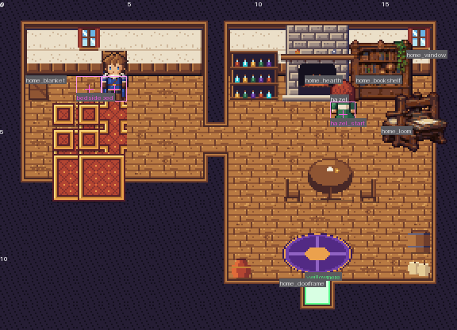
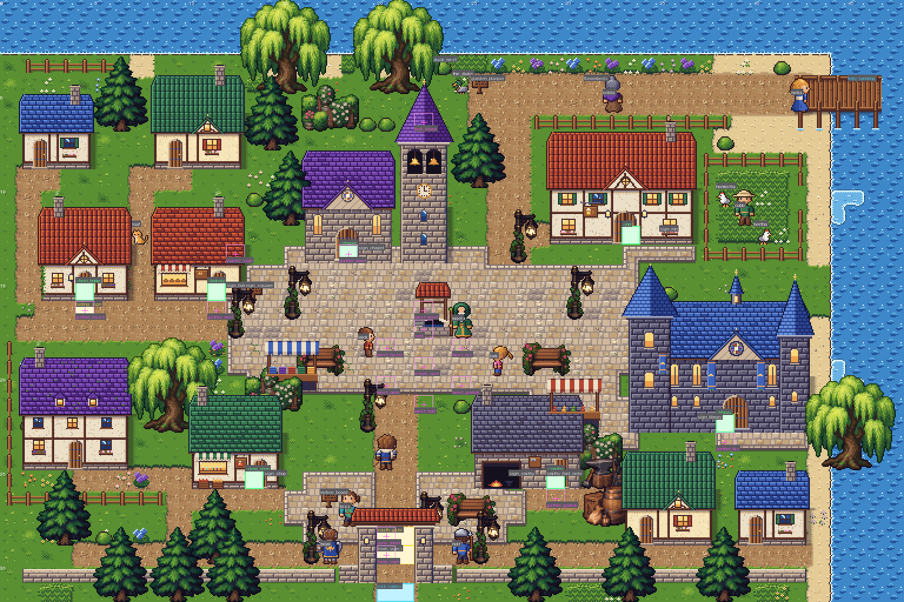
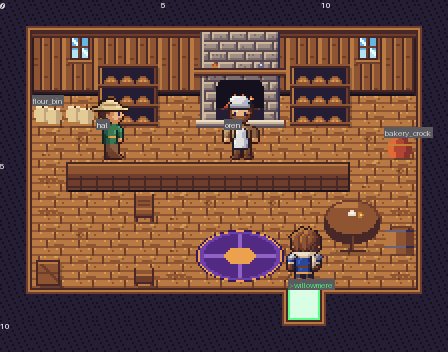
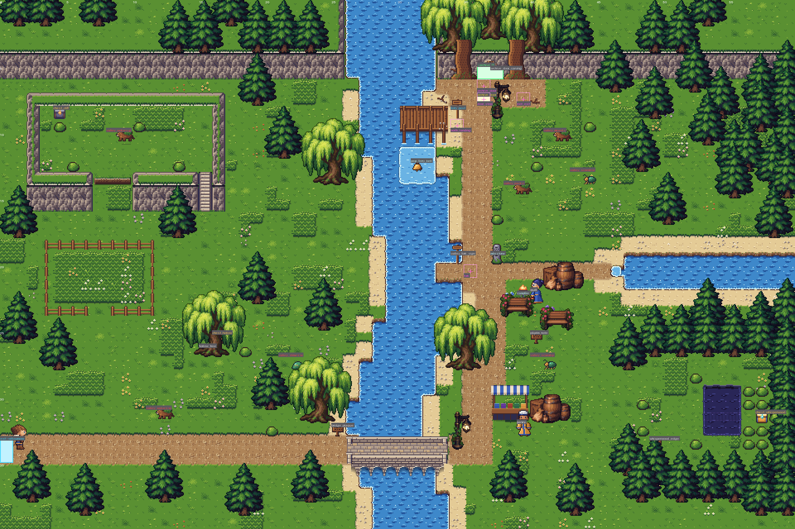
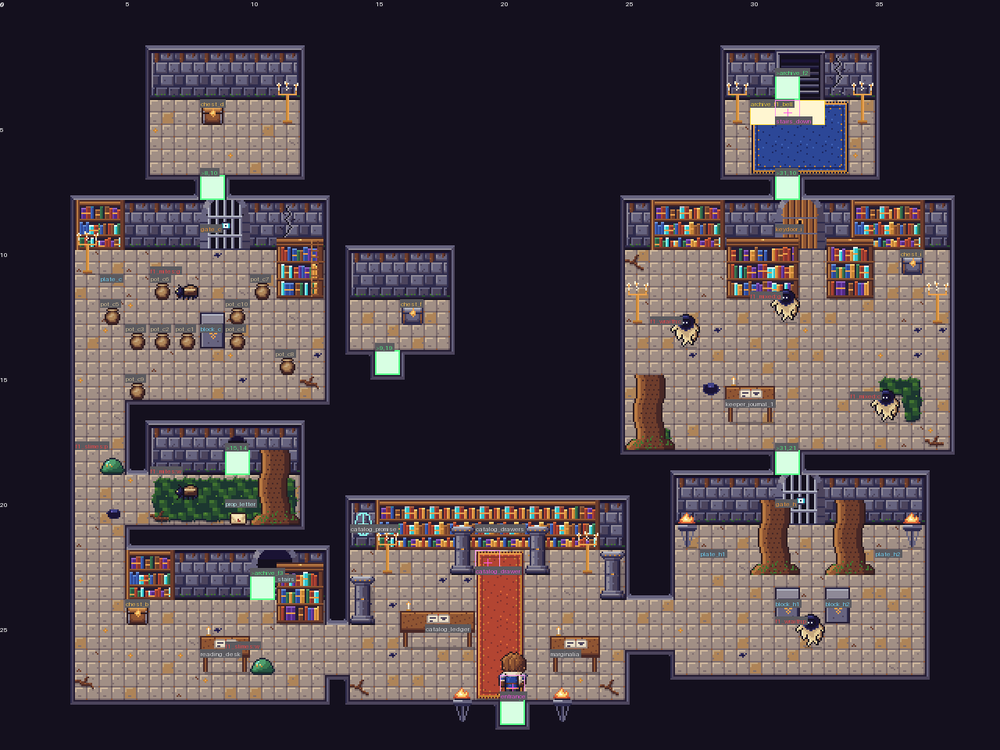
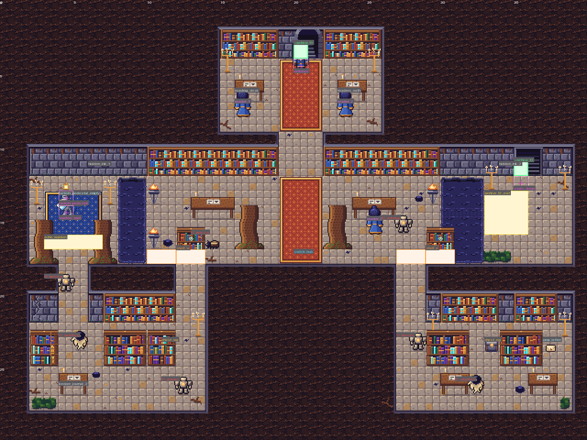
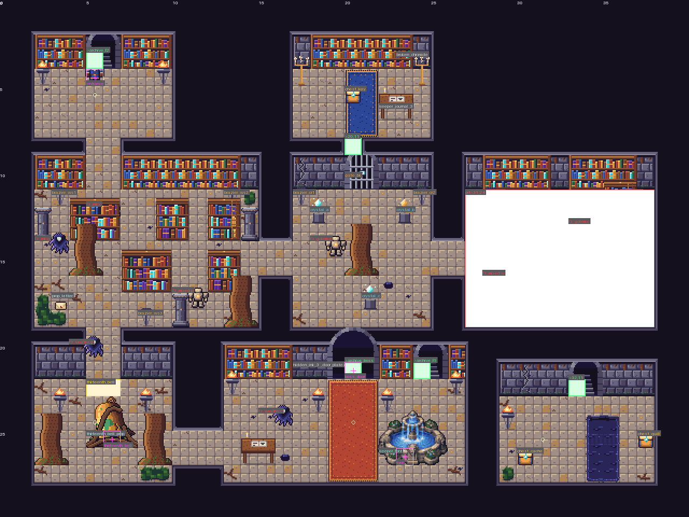
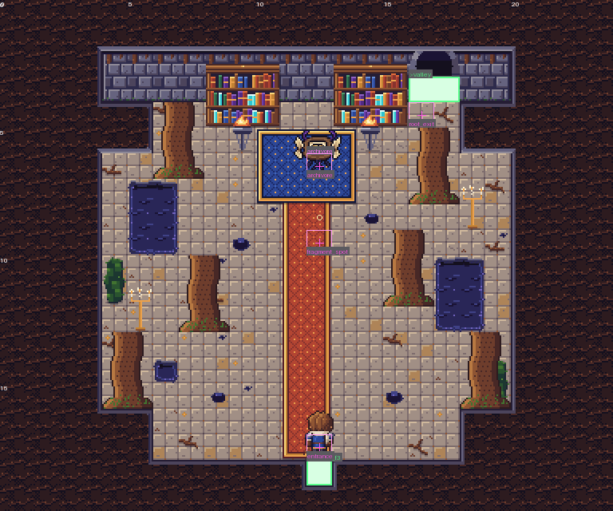

# Maps: Episode 1 (W2-maps)

Every Episode 1 map is a data module in `src/data/maps/<id>.js` (DESIGN 5.1 plus the fields in section 2).
Helpers live in `src/data/maps/_kit.js`; the default export is always a plain, JSON-serializable object.
Tools: `tools/maps/mapcheck.mjs` (dump, validate, walk), `tools/maps/preview.py` (PNG previews).
Tests: `qa/maps/maps.test.mjs`. Annotated overviews (2x) are in `tools/maps/previews/`.

```bash
node tools/maps/mapcheck.mjs check                 # every map: ids, targets, NPC coverage, plans, STAGING marks, walk
node tools/maps/mapcheck.mjs dump willowmere       # the resolved module as JSON
node tools/maps/mapcheck.mjs walk archive_f1       # gate-aware reachability report
python tools/maps/preview.py willowmere --walk     # tools/maps/out/willowmere.png (3x, labels) + _clean.png
python tools/maps/preview.py archive_f3 --crop=27,9,13,12 --scale=4
python tools/maps/preview.py --all --scale=2
```

---

## 1. Conventions

- **Coordinates** are tiles, `(0,0)` top-left. `ground` rows are strings; the legend maps a character to a
  terrain, `<wall>_top` / `<wall>_face`, a plain tile or a line16 tile (ids from `assets/tiles/tiles.json`).
- **3/4 view walls.** Rooms are carved out of a grid of wall top (`#`): the floor rectangle plus two face rows
  (`|`) above it (`room()` in `_kit.js`). Walls that run north-south show only their top. Outside the rooms the
  top fill draws as dark roots (archive) or dark plaster (interiors).
- **Doors and stairs set into a face** (`door_key_*`, `door_locked_*`, `door_boss_*`, `stairs_*`, `stairs_in_*`,
  the valley's `door_double_*`) are **transfers**: the object sits in `decor` at its doorAt cell and a `door`
  event on the same cell carries `to`. Inside one dungeon floor the far side is a one-cell floor **notch** cut
  into the destination room's south wall strip, with a return `door` on the notch (event ids `notch_*`). The
  engine never fires a door on placement, only on stepping onto it.
- **Interiors** exit through a gap in the south wall; the town door's `to` lands on that gap cell facing up,
  the interior's exit lands on the tile in front of the building door facing down (tested).
- **Overlays** are decal/plain tiles drawn over the ground cell. The overlay's own collision replaces the
  cell's: bridge decks over water are walkable, bridge piles/arches stay water, `wall_broken` over a face is a
  walkable hole, `ink_bridge_*_faint` over ink is a `pit` until the Lantern reveals it, `plate_*`, `switch_*`,
  `roots_*`, flowers are `none`. A 16x32 overlay applies to both rows it covers.
- **Decor** entries are tiles.json objects (anchor = bottom-left footprint tile) or props.json objects
  (`x,y` = left tile of the bottom footprint row), with `state` = frame index when the object has frames
  (`lamp_post` 1 = lit; the field overrides a lamp's state by time of day: lit under dawn/dusk/night and in
  dark maps, unlit by day). Plain tiles with `w`/`h` repeat.
- **Mechanism events draw themselves** (`block`, `plate`, `switch`, `shelf`, `gate`, `locked_door`,
  `brazier`, `font`, `chest`, `pot`, `object`): no duplicate decor. `gate`/`locked_door` with a 32 px door sprite
  own both doorway cells (`w: 2`); `door_boss` owns three.
- **Signs** sit on the solid thing they describe (a wall face, a building footprint cell, a prop) and are read
  from the adjacent floor; `solid: false` means the event adds no collision of its own.
- **Marks** (`marks: { name: [x, y] }`) are the named points scenes refer to (STAGING.md section 5 plus a few
  extras). Marks that scenes walk actors to are tested walkable and reachable.
- `start: { x, y, dir }` is the default spawn (debug warps, tests). `under` is the terrain drawn beneath walls
  and plain tiles. `pitTo` is where `pit` cells drop you unless a `pit` area event overrides it.

## 2. Event vocabulary (agreed with W2-world)

Every event: `{ id, type, x, y, if?, ifNot? }`. The event exists only while its flag conditions hold.

| type | fields | notes |
|---|---|---|
| `npc` | `dir` | `id` = `npcs.js` id; sprite, movement, presence and talk come from `NPCS` |
| `actor` | `sprite, dir` | scripted map actors `echo_warden`, `archivore`; the F2 ink readers carry `ghost: true, solid: false` |
| `door` | `to: [map,x,y,dir], kind: 'door'|'stairs', w?` | transfer on step; same-map transfers allowed |
| `chest` | `tier, item?, qty?, flag?` | no `item` = `rollChest(tier)`; one-shot via `engine.game.opened`; `flag` only on `stacks_key` |
| `sign` / `book` | `text` / `book`, `tile?`, `fade?`, `lantern?` | `fade` = `shop|inn|square|gate` for the flag-driven blank states; `lantern: true` = readable once revealed |
| `object` | `sprite, script?, text?, solid?, state?` | inspectables: letters, milestone, pedestal, nest, bell, the boss door; flag swaps are two events with `if`/`ifNot` |
| `trigger` | `w, h, script, on?` | `on: 'enter'` runs after the fade-in; default = step; scenes guard themselves |
| `enemy` | `sprite, encounter, move, path?, radius?` | `move` = `wander|patrol|chase|guard`; dungeon enemies step only when the player steps |
| `switch` | `target, kind: 'floor'|'crystal', color?, state, hidden?` | toggles on interact; every target fires |
| `plate` | `target` | down while a block or party member stands on it |
| `block` | | push block, resets on re-entry |
| `gate` | `sprite, state, to?` | opens when **all** switches/plates targeting it are on; with `to` it is then a door |
| `locked_door` | `key, sprite, to` | interact with the key; `archive_key` is consumed |
| `shelf` | `positions, state` | slides between positions when a switch targeting it fires |
| `pot` | `item?, qty?, gold?` | breakable, respawns on re-entry |
| `brazier` | `lit` | interact to light; a light source in dark maps |
| `font` / `save` | `text` | Keeper's font (full heal) / chapel bell (save); both set the game over return point |
| `ferry` | `text, to, rideIf` | the post is readable always; the ride needs `nella_bell_done` |
| `light` | `r, color?` | extra light source; `r` under 16 is in tiles (F3 uses 4 to 7), otherwise pixels |
| `pit` | `w, h, to` | overrides `pitTo` inside an area |

`object` / `actor` / `trigger` may add `safe: true` (the F2 Lantern pedestal): using it makes the party's
tile the game over return point. A map may add `ambientFx: ['motes']` (the library) to its ambient life;
see docs/WORLD.md 1b. Stairs transfers and map-to-map doors set the return point by themselves; same-map
notch doors and pits do not.

## 3. Collision and the walk model

`tools/maps/mapcheck.mjs buildGrid()` derives the collision grid exactly as section 1 says (terrain code, wall
systems solid, overlay override, decor footprints solid except doorAt/passable cells, door cells walkable,
gates and locked doors solid until opened, standing events solid). `walk()` floods from `start` with
4-direction moves, one-way ledges, pits (drop to `pitTo`), same-map door transfers, and iterates the gates: a
gate opens when all of its sources are reachable (a plate also needs a push block on the map), a locked door
when its key chest or pot is reachable, hidden ink becomes walkable once the Lantern pedestal is reachable (or
`{ lantern: true }` is passed), shelves become passable once their switch is reachable. Enemies, blocks, pots
and actors are passable for the flood (fought, pushed, broken, despawned). The test suite asserts the critical
path, every chest and every story mark from this model.

---

## 4. The maps

### hero_home (18 x 13, interior)

Sleeping loft (left) and Hazel's main room (hearth, loom, table, bookshelf). `bed` = (4,3) = `START_POS`;
`bedside` = (3,3); the tile below the bed is floor. Hazel starts by the hearth (13,4). Six inspect lines.
Exit (12,11) lands on the town tile in front of the front door (4,16).

### willowmere (48 x 32, town)

Lantern Square (plaza, the well, Mael, Wick, Lark, benches, stalls, lamp posts, the LANTERN SQUARE sign)
with the chapel and bell tower north of it, the library east (chicken run behind it, Cobb and the hens, its
gate on the east bank), the hero's home and bakery on the west lane with Loaf's alley between them, the inn and
ferry pier north-east, Edda's twelve beds and the thirteenth on the bank along the river road, the Duke's nest
in the reeds, the main road south through the south square (notice board, Tess) to the gate (Bram left post,
Holt right post, the WILLOWMERE sign in the arch), item shop south-west, smithy south-east, five homes with
gardens, a low town wall along the south edge. Every shop sign is a `sign` event with `tile` and `fade`.
Triggers: `fading_sign` on `home_door`, `south_gate` on `gate_inner` (row 28), `leave_town` in the arch (row
29), `return_to_willowmere` on enter. Exit: the gate row 31 to the valley's south-west corner; the ferry pier to
the valley north landing once the bell is back.

### Interiors

`bakery` (Oren behind the counter by the oven, Hal by the flour bin after the Archivore, the crock),
`inn` (taproom with Hob, the stair to the guest rooms where Barnaby sleeps), `item_shop` (Pell), `smithy`
(Garrick at the anvil by the forge, the runaway starter on the warm bricks beside it, Anvil the dog by the
door), `library` (Iris at her desk facing the door, Mira at her reading table facing the shelf, `mira_meet`
two tiles inside the door, seven books, the globe, the returns cart, a mezzanine by stair), `chapel` (altar,
pews, the bell-tower base with Pip under the ropes, the hand-bell save point by the door). Previews:
`tools/maps/previews/<id>.png`.

### valley (60 x 40, field)

Enter from the town gate at the west edge (1,33). The road runs east to the stone bridge (Penny's cart and
crates at the far end), the pilgrim road north along the east bank with a jog around the willow, the fork
(milestone object, fork signpost, the Pilgrim's Rest: campfire, log benches, Quill, and the pilgrims' note
`pilgrim_note` on a post at (40,25) that hints at the Whisperwood pool and its ink crossing), the east road ending at the
washed-out ford of a tributary, the Whisperwood pines on the east edge, and the Rootbound Archive grown into
the north cliff: the great door in the rock face under three willows with root columns, `door_step` (36,7) with
open tiles each side, `root_exit` (39,7) where the boss chamber's passage comes out. North landing: sand, pier,
the empty bell post (`ferry` event), Nella's bell glinting in the shallows just downstream. West: the meadow,
a fenced pasture, the hollow willow (wood chest: Echo Herb x2 under the canopy), a cliff plateau with stairs,
an iron chest (spare Hatchet) and a grassy ledge for a one-way hop down. Secrets: the Whisperwood clearing's
ink pool with a hidden ink bridge to a gold chest (Thornwake; needs the Lantern, so it is found on the way
home). Seven visible enemies per the plan: wolves first by the start, the pack deepest by the Archive. Rain
zone: the north half (`weatherZone`).

### archive_f1 (40 x 30): The Catalog Halls

Entrance hall A with the catalog drawer wall (`catalog_drawer` (19,22) faces it), the Catalog Promise plaque,
the ledger and the marginalia desk. **Critical path:** east corridor to the plate room H (push two blocks onto
two plates between the root columns; the barred door opens) into the east wing I (three fights, iron chest,
shelf aisles) and its key door, then the stairs landing J where the bell tolls (trigger row 4) and the stairs
down. **The key:** west corridor to the pot storeroom C: break the pots to free the push block, push it west
four and north two onto the plate; the barred door opens into the key alcove D (wood chest, Archive Key).
**Optional:** the moss alcove E (Tess's letter 1) with a broken wall into the hidden cell F (iron chest, the
Wayfarer Mantle); wood chest in the antechamber B. The F3 shortcut surfaces in B's north face once
`archive_f2_done` is set. Eight enemies as planned (slimes in B and the corridor, mites guarding the pots and
the alcove, wraiths and mixed groups in H and I).

### archive_f2 (40 x 30): The Reading Galleries

One long gallery band cut by ink moats: the Echo Warden's rotunda (west) | ink | the Reading Hall hub | ink |
the stairs room (east). Ghostly readers sit at the desks of the entry hall and the hub. The hub's floor switch
slides two shelves along their rails so only one south doorway is open at a time (start: east open). East
wing: the reading rooms, Tess's letter 2 (south-east), the Iron Pike chest. West wing: the long gallery, the
Chain Shirt chest, then north through the gallery's wall into the rotunda from the south: the Warden faces down
over the Lantern pedestal (trigger row 16 across the rotunda). With the Lantern, the ink beside the pedestal
reveals a bridge straight back into the hub (the shortcut), and the hub's east moat reveals the bridge to the
stairs room (`archive_f2_exit` trigger in front of the stairs, `hidden_ink_2` on its wall). Seven ordinary
enemies plus the Warden. Faint bridges are pits until revealed (`pitTo` = the hub).

### archive_f3 (40 x 30): The Rootbound Stacks (dark 0.7)

**Main path:** entry (north-west) down into the western stacks (dark; three braziers to light; shelf aisles
split by roots; letter 3 wedged between roots at (3,17)), south through the corridor to the bell hollow (the
thirteenth bell between two root columns, trigger at the hollow's mouth, braziers), east to the great door hall:
the boss door with its plate and `hidden_ink_3` beside it, the Keeper's font, the shortcut stairs back to F1's
antechamber. **Branches:** the crystal room (three crystal switches, all lit opens the barred door to the key
room above: the gold chest with the Stacks Key, the Keeper's third journal, the broken chronicle); the pit room
(a golem and a patrol among the pits; falling drops into the cache below: a gold chest, a brazier, and across a
hidden ink bridge the First Quill; the cache's stairs climb back to the pit room, one way). Eight enemies with
ink wraiths in the stacks and the corridors.

### archive_boss (24 x 20): Heart of the Archive

A hollow inside the willow: root columns, ink seeping from the walls, a carpet of pages up the middle. The
party enters from the south notch; the Archivore feeds at the north end over the blue carpet (`archivore`
(12,6), `fragment_spot` (12,9)). After `archivore_defeated` the root passage opens in the north face
(`root_exit` (16,4)) and leads out to the valley beside the Archive door.

---

## 5. Open items and assumptions

- The world renderer decides the look of the fading signs (the prefab facades already paint the sign; the
  `sign` events say which tile and where), the ink readers (`ghost: true`) and the Lantern reveal radius.
- Push blocks and pots reset on re-entry; opened gates, locked doors and revealed ink persist per save.
- The valley `weatherZone` is the north half; ignore it if the renderer does not do zones.
- Private homes in Willowmere are not enterable (COMMON.md fixes the map id list).
- The crystal "sequence" is any order (all three lit); a strict order needs a `seq` rule the engine does not have.
